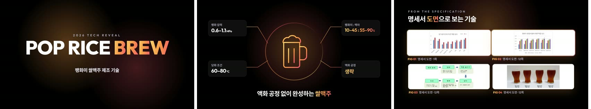
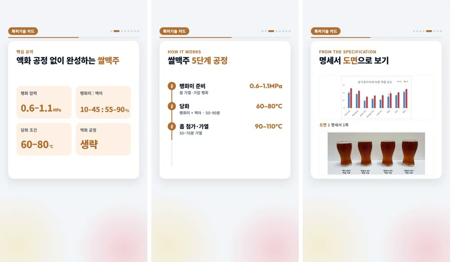
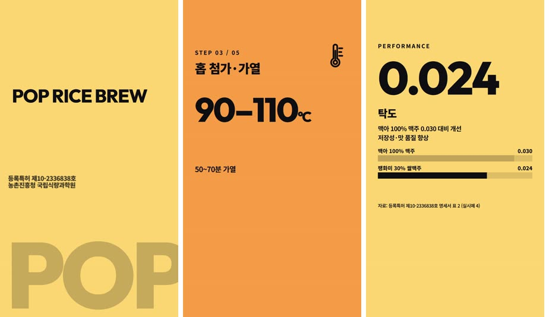
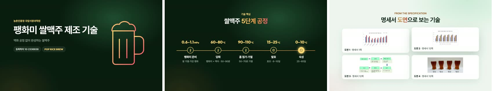
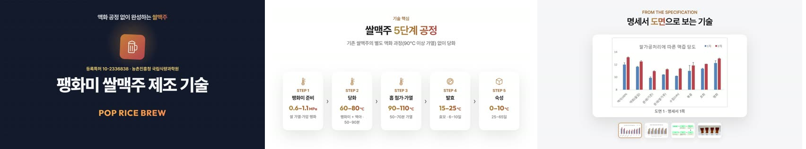
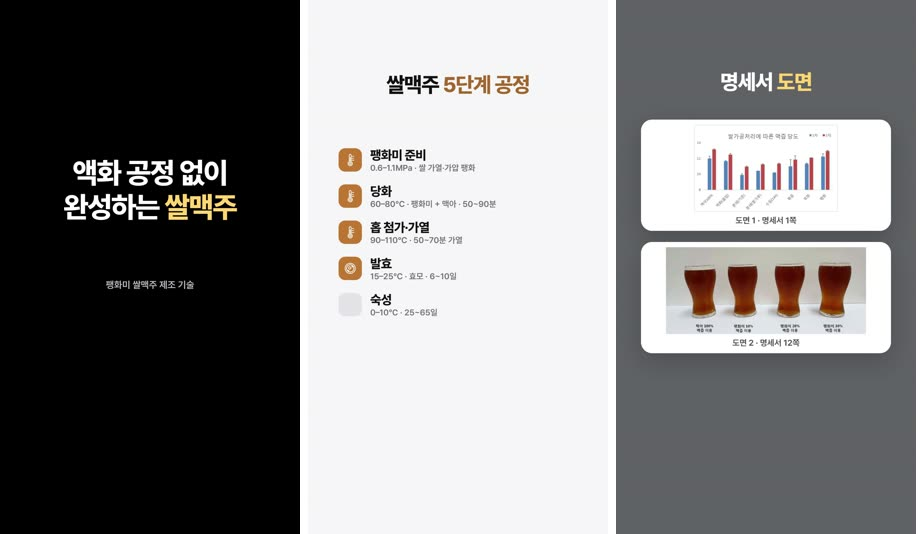
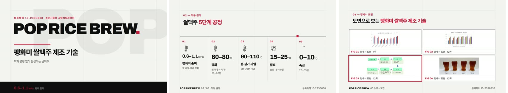
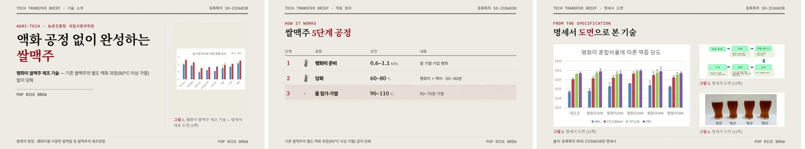
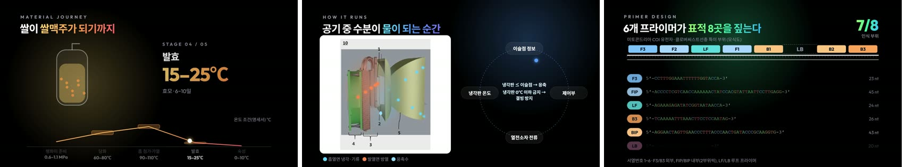

# patent-tech-video — 특허 기술소개영상 제작 스킬

Claude Code용 스킬입니다. 특허 목록(출원번호·엑셀)을 받아 KIPRIS Plus API로 명세서·청구항·도면을 모으고,
명세서 기반 콘텐츠(JSON)를 쓴 뒤 HyperFrames로 템플릿별 MP4를 렌더링합니다.

- 템플릿 10종: A 언팩 · B 카드뉴스(9:16) · C 키네틱(9:16) · D 그린 에디토리얼 · E 모노 콘트라스트 · F 스테이트먼트(9:16) ·
  G 스위스 그리드 · H 오가닉 소프트테크 · I 뉴스룸 에디토리얼 · S 시그니처(기술 유형별 구성)
- 선택: edge-tts 한국어 나레이션, 원본 엑셀에 영상 파일명 기재

자세한 사용법은 [`SKILL.md`](SKILL.md), 템플릿 구성은 [`references/templates.md`](references/templates.md),
콘텐츠 작성 규칙은 [`references/CONTENT_SPEC.md`](references/CONTENT_SPEC.md)를 보세요.

## 템플릿 미리보기

같은 특허(등록특허 10-2336838 팽화미 쌀맥주 제조 기술) 하나로 만든 장면입니다. S는 유형별로 세 특허를 썼습니다.

### A 언팩 · 16:9 · 60초
검은 무대에 그라디언트 코드네임, 스펙 칩, 명세서 도면 스포트라이트. 발표회·전시용.


### B 카드뉴스 · 9:16 · 50초
흰 카드가 옆으로 넘어가는 정보형 숏폼. 핵심 요약 → 공정 → 도면 카드.


### C 키네틱 · 9:16 · 49.5초
원색 면이 차오르며 거대 숫자·단어로 비트마다 끊어 가는 릴스·쇼츠형.


### D 그린 에디토리얼 · 16:9 · 60초
민트 종이와 숲색 인터루드, 유리 카드. 기관 홍보형.


### E 모노 콘트라스트 · 16:9 · 56.5초
흑·백·남색 격자를 오가는 애플식 중앙 서사, 도면이 차례로 바뀌는 스테이지.


### F 스테이트먼트 · 9:16 · 40.5초
한 화면 한 메시지의 짧은 광고형 숏폼.


### G 스위스 그리드 · 16:9 · 60초
종이색 그리드, 큰 숫자, 빨강 한 색 강조. 코드네임이 파티클에서 조립되고, 도면 위로 선택 틀이 이동.


### H 오가닉 소프트테크 · 16:9 · 57.5초
베이지 바탕의 둥근 카드와 방사형 노드, 물결 경로 위 공정, 도면 카드 부채꼴.


### I 뉴스룸 에디토리얼 · 16:9 · 56초
신문 지면처럼 세리프 제목, 이중 괘선, 공정 표, 도면 포토 에세이.


### S 시그니처 · 16:9 · 52~55초
기술 자체가 움직이는 템플릿. 왼쪽부터 공정형(재료 여정 + 온도 그래프), 장치형(도면 위 작동 흐름 + 제어 루프),
서열형(프라이머 염기 서열이 표적 부위를 짚음). 콘텐츠에 `signature` 블록이 필요합니다.


## 설치

```bash
git clone https://github.com/kimjs3176-prog/patent-video-skill.git ~/.claude/skills/patent-tech-video
```

필요한 것: Node.js(`npx hyperframes`), ffmpeg, Python 3 + `openpyxl` `pypdf` `fonttools` `brotli`, 나레이션 시 `uv`.

## 이 저장소에 없는 것

| 항목 | 이유 | 대신 |
|---|---|---|
| KIPRIS Plus 서비스키 | 비밀 정보 | 프로젝트 `.env`에 `KIPRIS_API_KEY=...` (커밋 금지, `.gitignore` 포함) |
| 배경음악 | 저작권이 사용자에게 있음 | 라이선스를 가진 mp3를 `<프로젝트>/assets/music`에 넣거나, `tools/music.py`로 준비(HeyGen 라이브러리 / Google Lyria / MusicGen, media-use 스킬 필요). 없으면 무음으로 빌드 |
| 효과음 | Pixabay 콘텐츠를 단독 재배포하지 않음 | HyperFrames `media-use` 스킬이 설치돼 있으면 `setup_project.py`가 자동 복사(없으면 생략) |

## 보안 메모

- KIPRIS 호출은 HTTPS만 사용하고, 공보 PDF는 KIPRIS 도메인에서만 받습니다.
- 콘텐츠 JSON은 모델이 제3자 문서(명세서)에서 쓴 것이므로 `validate.py`가 `<br />` 외 HTML 태그와 경로가 섞인 도면 파일명을 거부합니다.
- 실행 시 받는 도구는 버전을 고정합니다: `hyperframes@0.8.207`, `edge-tts==7.3.1`, GSAP `3.14.2`(jsDelivr).
- edge-tts는 Microsoft Edge 온라인 읽기 서비스를 비공식으로 사용합니다(나레이션 문장이 외부로 전송됨). 공공 배포 전 이용 조건을 확인하세요.

## 서드파티 고지

[`NOTICE.md`](NOTICE.md)를 보세요. 이 저장소의 코드에 대한 라이선스는 아직 지정되지 않았습니다.
