# patent-tech-video — 특허 기술소개영상 제작 스킬

Claude Code용 스킬입니다. 특허 목록(출원번호·엑셀)을 받아 KIPRIS Plus API로 명세서·청구항·도면을 모으고,
**특허마다 그 기술이 실제로 움직이는 구조를 뽑아** 모션그래픽으로 설계한 뒤, HyperFrames로 나레이션이 들어간 MP4를 만듭니다.
한 건이든 수백 건이든 같은 흐름입니다.

## 주요 기능

- **특허마다 다른 모션.** 콘텐츠를 쓰기 전에 "무엇이 바뀌나·흐르나·알아보나"를 먼저 뽑아(특징 구조화) 시그니처 템플릿 S의 장면으로 만듭니다.
  공정 특허는 재료 여정, 장치 특허는 도면 위 매질 흐름, 진단 특허는 서열 인식과 판독이 화면의 주인공이 됩니다.
- **구조 검사.** `validate.py`가 글자 수·마크업과 함께 시그니처 구조(단계 그림, 매질 흐름, 도면 좌표, 염기 서열)를 검사하고,
  `sigcheck.py`가 여러 건 사이에 같은 구성으로 보일 영상을 알려 줍니다.
- **도면을 그래픽으로.** 어떤 특허든 흑백 선 도면은 선을 자동으로 뽑아 펜으로 그리듯 그린 뒤 원본이 떠오르고(`figtrace.py`),
  "부호의 설명" 대조표와 측정 격자(`figmap.py`)로 찍은 부품 위치에 도면 부호 표식이 목록과 함께 나타납니다.
- **템플릿 10종.** A 언팩 · B 카드뉴스(9:16) · C 키네틱(9:16) · D 그린 에디토리얼 · E 모노 콘트라스트 · F 스테이트먼트(9:16) ·
  G 스위스 그리드 · H 오가닉 소프트테크 · I 뉴스룸 에디토리얼 · **S 시그니처(기본 권장)**. 같은 콘텐츠 JSON으로 모두 뽑을 수 있습니다.
- **엔딩 문구는 `branding.json`에서, 특허권자는 공보에서.** 기술이전 문의처·면책 문구는 프로젝트의 `branding.json`에서 바꾸고(특허마다 다르면 콘텐츠 JSON의 `branding`), 특허권자는 공보 첫 장의 (73) 특허권자(공개공보는 (71) 출원인)를 그대로 씁니다.
- **키 없이도 끝까지.** 배경음악은 파이프라인이 직접 작곡·연주하고(`compose.py`), 나레이션은 무료 edge-tts, 그림·장면은 코드로 그립니다. 키(Google TTS·Lyria)는 품질을 올리는 선택 사항입니다. KIPRIS 키가 없으면 공보 PDF를 직접 받아 `kipris.py --pdf`로 씁니다.
- **한국어 나레이션 기본 포함.** `.env`에 `GOOGLE_TTS_API_KEY`가 있으면 Google Chirp 3 HD(`ko-KR-Chirp3-HD-Aoede`, 사람 성우에 가까운 음성),
  없으면 무료 edge-tts 선희(`ko-KR-SunHiNeural`)로 장면마다 한 줄씩 읽고, 엔딩은 음악만 둡니다. 화면용 기호(`~`, `℃`, `·`, 단위)는 합성 전에 읽는 말로 바뀝니다.
  보통 속도로 먼저 읽고 장면에 안 들어갈 때만 빨라집니다(`--no-narrate`로 끄기).
- **산출물 규칙.** 동영상 `patents/{출원번호}.mp4`, 썸네일 `patents/{출원번호}.jpg`, 자막 `patents/{출원번호}.srt`(예: `patents/1020240012345.mp4`).
- **자막 기본 포함.** 읽힌 나레이션이 화면 하단 자막으로 구워지고 `.srt`로도 나옵니다(`--no-captions`로 끔).
  원본 엑셀은 그대로 두고, 사본의 마지막 열에 영상 파일명을 적습니다.

자세한 사용법은 [`SKILL.md`](SKILL.md), 템플릿 구성과 모션 원칙은 [`references/templates.md`](references/templates.md),
콘텐츠·시그니처·나레이션 작성 규칙은 [`references/CONTENT_SPEC.md`](references/CONTENT_SPEC.md)를 보세요.

## 작동 흐름

| 단계 | 하는 일 | 도구 |
|---|---|---|
| 1. 준비 | 프로젝트 폴더, 폰트·템플릿 복사, 엑셀·출원번호로 제작 순서 정리 | `setup_project.py`, `master_list.py` |
| 2. 명세 수집 | 서지·청구항·공보 전문·도면 | `kipris.py`, `extract_figs.py` |
| 3. 특징 구조화 | 한 문장 요약 + 다섯 질문 → `signature` (도면을 직접 열어 좌표를 찍음) | Claude / 서브에이전트, `sigcheck.py` |
| 4. 콘텐츠 작성 | 명세서 수치 그대로, 말하는 문장의 나레이션 대본 | `validate.py` |
| 5. 빌드·검사·렌더 | 템플릿 빌드 → 나레이션 → HyperFrames 검사 → 렌더 → `patents/`로 내보내기 | `produce.py`, `export.py` |
| 6. 마무리 | 원본 엑셀 사본에 영상 파일명 기재 | `annotate_lists.py` |

```bash
python -I ~/.claude/skills/patent-tech-video/scripts/setup_project.py ~/patent-video-demo
cd ~/patent-video-demo
python -I tools/master_list.py "추천특허.xlsx"                        # 또는 출원번호들
PYTHONIOENCODING=utf-8 python -I -u tools/kipris.py --all             # .env의 KIPRIS_API_KEY 사용
#  … data/content/<순번>-<출원번호>.json 작성 (Claude가 CONTENT_SPEC에 따라) …
PYTHONIOENCODING=utf-8 python -I tools/validate.py data/content/*.json
PYTHONIOENCODING=utf-8 python -I tools/sigcheck.py data/content/*.json
PYTHONIOENCODING=utf-8 python -I -u tools/produce.py --template S     # → patents/{출원번호}.mp4 · .jpg
```

## 시그니처 템플릿 S — 특허의 구조가 장면이 된다

16:9 · 46~55초. 장면 수와 길이는 그 특허의 데이터(단계·부품·프라이머 수)에 맞춰 정해지고, 데이터가 있을 때만 장면이 더해집니다
(공정 비교, 두 번째 도면 경로, 프로브 비교).

### 공정형 (journey) — 재료가 바뀌는 길
4~6단계마다 재료 그림이 바뀌고(침지·절단·증숙·데침·건조·로스팅·유탕·동결·발효·혼합·추출·분쇄·성형·접종·살균·코팅·포장·농축·수확·압출·굽기·발아·재배·세척·탄화·해동·광 조사·초음파 등 33종),
명세서 온도 조건으로 그래프가 단계별로 이어지며 점이 다음 온도로 옮겨 갑니다. 마지막에 완성품이 나타납니다.
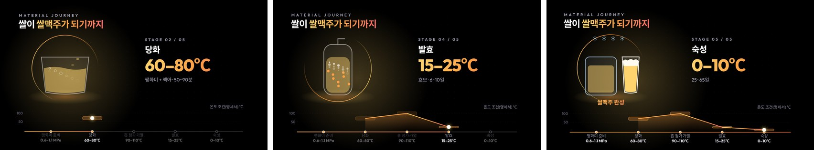

### 장치형 (loop) — 도면 위로 흐르는 매질
명세서 도면에 부품을 짚고, 같은 도면 위로 공기·물·가스·고형물·빛·전력이 실제 경로를 따라 흐릅니다.
옆에는 청구항의 제어 루프(센서 → 제어 → 구동)나 작동 단계가 돌고, 두 번째 도면이 있으면 그 위로 경로를 따라갑니다.
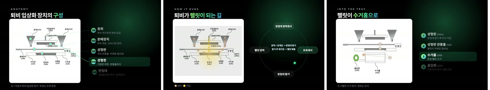

### 배합형 (formula)·계통형 (lineage)
조성물·추출물은 성분이 명세서 비율대로 용기를 채운 뒤 효능이 대조군 대비 막대로, 품종·균주는 교배(또는 분리원)에서 신품종까지 계보가 그려진 뒤
형질이 대비 품종과 나란히 비교됩니다. 공정·장치·서열이 없는 특허도 시그니처로 만들 수 있습니다.

### 청구항형 (claim) — 어떤 특허든
다른 유형이 맞지 않으면 claim을 씁니다(모든 특허에 쓸 수 있는 범용 유형). 등록 청구범위의 독립항이 구성요소별로 하나씩 조립되고,
구성요소마다 선이 그어져 도면 위 그 자리에 닿습니다(짚을 도면이 없으면 구성 블록이 틀 안에 조립됩니다). 이어 특징부가 빛나며 나머지가 물러나
무엇이 새로운지 보이고, 청구항 지도에서 종속항이 인용한 항으로부터 가지를 뻗습니다. 실시예 수치가 하나 있으면 마지막에 대조와 나란히 섭니다.

### 서열형 (sequence) — 인식하고 판독한다
배경기술 수치로 문제를 세우고, 프라이머가 실제 염기를 한 글자씩 찍은 뒤 표적 부위로 날아가 켜집니다.
판독은 명세서의 방식대로: Ct 증폭 곡선, 반응 튜브 색 변화, 다중 전기영동 밴드(실제 bp) 중 하나.
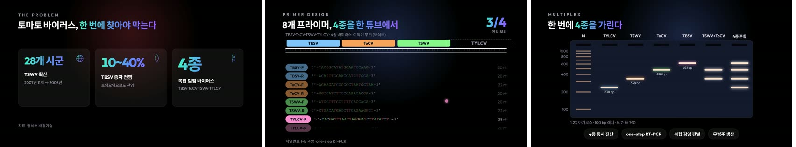

| 특허 | 유형 |
|---|---|
| 식품·가공·추출·발효 공정 | journey |
| 장치·설비·재배 시스템·센서, SW·제어 시스템(구성도) | loop |
| 프라이머·마커·진단 키트 | sequence |
| 미생물·균주 | 배양·발효가 핵심이면 journey, 진단 마커가 있으면 sequence, 선발된 균주 자체면 lineage |
| 조성물·추출물·기능성 소재 | 제조 공정이 핵심이면 journey, 배합 비율과 효능이 핵심이면 **formula** |
| 품종(분자마커 없음) | **lineage** |
| 다른 유형이 맞지 않는 것(항원·화합물·용도 발명 등) | **claim** — 모든 특허에 쓸 수 있는 범용 유형 |

## 도면 분석 — 어떤 특허든 도면이 그래픽이 된다

장치·시스템 특허의 구성 장면(모든 템플릿 공통). 흑백 선 도면이면 선을 자동으로 뽑아 펜으로 그리듯 그리고(`figtrace.py`),
원본 도면이 떠오른 뒤 부품마다 도면 부호 표식이 목록과 같은 순서로 그 자리에 나타납니다. 부품 위치는 `figmap.py`가 만든
"부호의 설명" 대조표와 10×10 측정 격자를 보고 찍습니다([`references/FIGURE_ANALYSIS.md`](references/FIGURE_ANALYSIS.md)).
사진·컬러 렌더 도면은 선 그리기 없이 원본과 표식만 나옵니다.
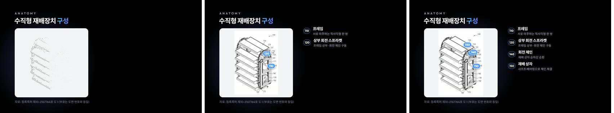

## 템플릿 A~I 미리보기

같은 특허(등록특허 10-2336838 팽화미 쌀맥주 제조 기술) 하나로 만든 장면입니다(현재 버전으로 렌더).

### A 언팩 · 16:9 · 60초
검은 무대에 그라디언트 코드네임(퍼지는 링·떠오르는 입자), 스펙 칩, 명세서 도면 스포트라이트. 발표회·전시용. S의 바탕 무대이기도 합니다.
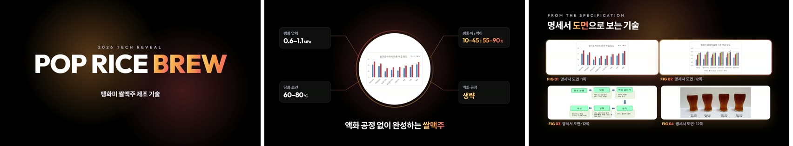

### B 카드뉴스 · 9:16 · 50초
흰 카드가 옆으로 넘어가는 정보형 숏폼. 핵심 요약 → 공정 → 도면 카드.
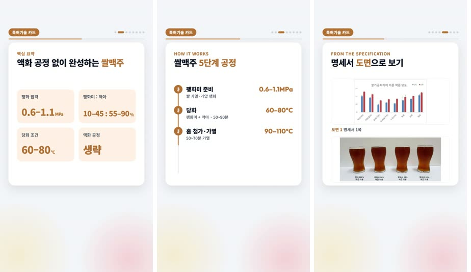

### C 키네틱 · 9:16 · 49.5초
원색 면이 차오르며 거대 숫자·단어로 비트마다 끊어 가는 릴스·쇼츠형.
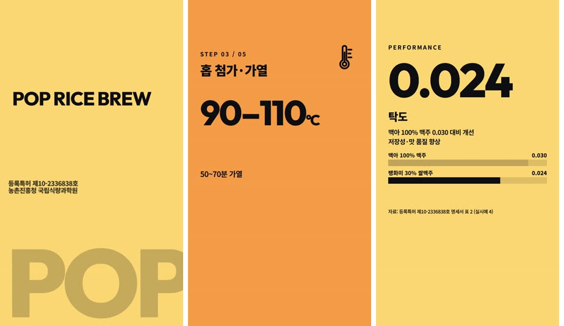

### D 그린 에디토리얼 · 16:9 · 60초
민트 종이와 숲색 인터루드, 유리 카드. 기관 홍보형.
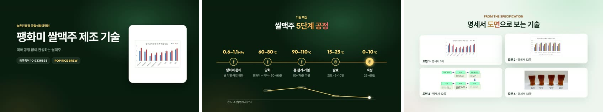

### E 모노 콘트라스트 · 16:9 · 56.5초
흑·백·남색 격자를 오가는 애플식 중앙 서사, 도면이 차례로 바뀌는 스테이지.
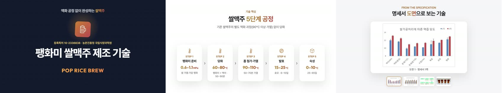

### F 스테이트먼트 · 9:16 · 40.5초
한 화면 한 메시지의 짧은 광고형 숏폼.
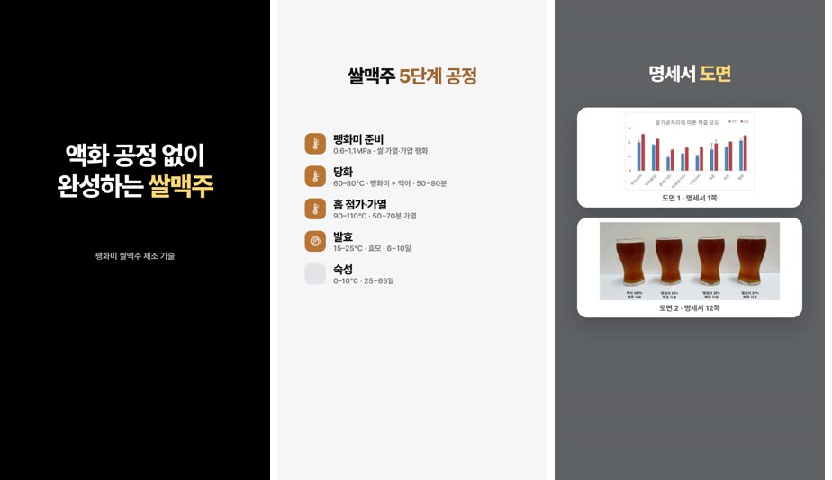

### G 스위스 그리드 · 16:9 · 60초
종이색 그리드, 큰 숫자, 빨강 한 색 강조. 코드네임이 파티클에서 조립되고, 도면 위로 선택 틀이 이동.
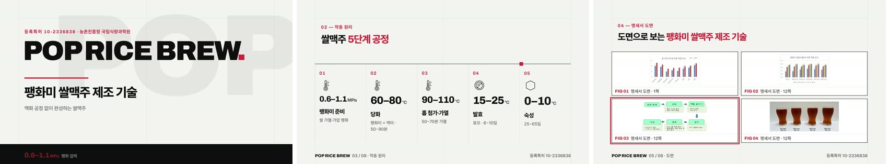

### H 오가닉 소프트테크 · 16:9 · 57.5초
베이지 바탕의 둥근 카드와 방사형 노드, 물결 경로 위 공정, 도면 카드 부채꼴.
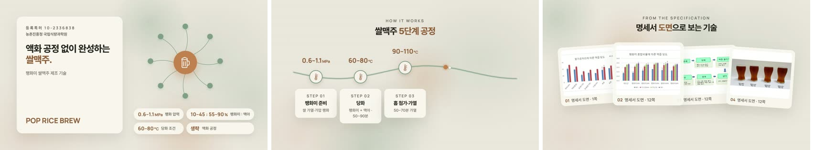

### I 뉴스룸 에디토리얼 · 16:9 · 56초
신문 지면처럼 세리프 제목, 이중 괘선, 공정 표, 도면 포토 에세이.
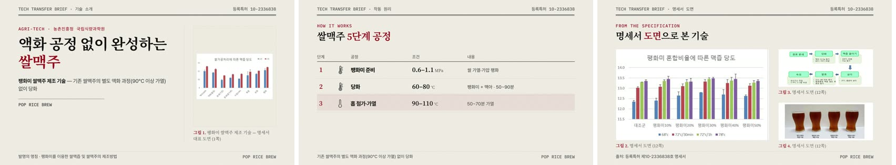

## 설치

```bash
git clone https://github.com/kimjs3176-prog/patent-video-skill.git ~/.claude/skills/patent-tech-video
python -m pip install -r ~/.claude/skills/patent-tech-video/requirements.txt
```

필요한 것: Node.js 18+(`npx hyperframes@0.8.207`, 첫 실행 때 내려받음), ffmpeg(`ffprobe` 포함), Python 3.10+ 와
`openpyxl` `pypdf` `fonttools` `brotli` `numpy`, 나레이션용 `uv`(`uvx edge-tts`). `setup_project.py`가 끝나면 빠진 도구를 알려 줍니다.
Windows에서는 한글 출력이 깨지지 않게 `PYTHONIOENCODING=utf-8`을 붙여 실행합니다.

## 이 저장소에 없는 것

| 항목 | 이유 | 대신 |
|---|---|---|
| KIPRIS Plus 서비스키 | 비밀 정보 | 프로젝트 `.env`에 `KIPRIS_API_KEY=...` (커밋 금지, `.gitignore` 포함). 키가 없으면 공보 PDF를 받아 `kipris.py --pdf`로 추출 |
| 배경음악 | 저작권 걱정 없음(직접 작곡) | `assets/music`이 비어 있으면 `produce.py`가 `compose.py`로 4곡을 직접 작곡·연주(키·외부 서비스 없음). 콘텐츠의 `music` 블록으로 특허마다 다른 곡. `.env`에 `GEMINI_API_KEY`가 있으면 Google Lyria 3.5(과금). 라이선스 있는 mp3를 넣어도 됨. `--no-music-gen`으로 끔 |
| 효과음 | Pixabay 콘텐츠를 단독 재배포하지 않음 | HyperFrames `media-use` 스킬이 설치돼 있으면 `setup_project.py`가 자동 복사(없으면 생략) |

## 보안 메모

- KIPRIS 호출은 HTTPS만 사용하고, 공보 PDF는 KIPRIS 도메인에서만 받습니다.
- 콘텐츠 JSON은 모델이 제3자 문서(명세서)에서 쓴 것이므로 `validate.py`가 `<br />` 외 HTML 태그, 경로가 섞인 도면 파일명,
  형식이 맞지 않는 시그니처 데이터(좌표·서열·도면 파일)를 거부합니다.
- 실행 시 받는 도구는 버전을 고정합니다: `hyperframes@0.8.207`, `edge-tts==7.3.1`, GSAP `3.14.2`(jsDelivr).
- edge-tts는 Microsoft Edge 온라인 읽기 서비스를 비공식으로 사용합니다(나레이션 문장이 외부로 전송됨). 공공 배포 전 이용 조건을 확인하세요.
- Google Chirp 3 HD는 Google Cloud Text-to-Speech 공식 API입니다(유료, 월 무료 한도 있음). Cloud 콘솔에서 Text-to-Speech API를 켜고 API 키를 만들어 `.env`에 `GOOGLE_TTS_API_KEY=...`로 넣으세요.

## 서드파티 고지

[`NOTICE.md`](NOTICE.md)를 보세요. 이 저장소의 코드에 대한 라이선스는 아직 지정되지 않았습니다.
