<p align="center">
  
</p>

<p align="center">
  <strong>출원번호만 주면, 명세서 수집부터 나레이션·자막이 들어간 MP4까지 만드는 Claude Code 스킬</strong>
</p>

<p align="center">
  
  
  
  
  
  
  
</p>

<p align="center">
  <a href="#빠른-시작">빠른 시작</a> ·
  <a href="#작동-방식">작동 방식</a> ·
  <a href="#템플릿">템플릿</a> ·
  <a href="#시그니처-템플릿-s">시그니처 S</a> ·
  <a href="#설치와-요구사항">설치</a> ·
  <a href="SKILL.md">SKILL.md</a>
</p>

---

**patent-tech-video**는 특허 목록(출원번호·엑셀)을 받아 KIPRIS Plus API로 명세서·청구항·도면을 모으고,
**특허마다 그 기술이 실제로 움직이는 구조를 뽑아** 모션그래픽으로 설계한 뒤, HyperFrames로 나레이션과 자막이 들어간 MP4를 만드는 스킬입니다.
한 건이든 수백 건이든 같은 흐름이고, 키가 없어도 끝까지 동작합니다.

```
patents/1020190145266.mp4   ← 영상(16:9 또는 9:16)
patents/1020190145266.jpg   ← 썸네일
patents/1020190145266.srt   ← 자막
```

## 왜 이 스킬인가

| 기술소개영상을 만들 때의 문제 | 보통의 방법 | 이 스킬 |
|---|---|---|
| 특허마다 영상이 비슷해 보인다 | 같은 템플릿에 문구만 교체 | 특허의 구조(재료 여정·매질 흐름·서열 판독·청구항)를 먼저 뽑아 **장면 자체를 바꾼다** |
| 수치가 명세서와 어긋난다 | 사람이 옮겨 적음 | 명세서 수치를 그대로 쓰고 `validate.py`가 형식·글자 수·구조를 검사 |
| 도면이 정지 화면으로만 지나간다 | 도면 이미지 한 장 | 선 도면을 펜으로 그리듯 그린 뒤 **도면 부호 위치에 표식** |
| 나레이션·자막 제작이 따로 든다 | 성우 녹음, 수동 자막 | 한국어 나레이션 자동 합성, 장면에 맞춘 속도 조절, 자막 띠와 `.srt` 자동 생성 |
| 수백 건을 만들기 어렵다 | 한 편씩 편집 | 순번 구간 단위 일괄 제작, 재실행 시 바뀐 것만 다시 렌더 |

## 주요 기능

- **특허마다 다른 모션** — "무엇이 바뀌나·흐르나·알아보나"를 먼저 뽑아(특징 구조화) 시그니처 템플릿 S의 장면으로 만듭니다.
- **템플릿 10종** — A~I와 S. 같은 콘텐츠 JSON 하나로 16:9·9:16을 모두 뽑습니다.
- **도면을 그래픽으로** — 흑백 선 도면은 선을 자동으로 뽑아 그려 내고(`figtrace.py`), "부호의 설명" 대조표와 측정 격자(`figmap.py`)로 부품 위치에 표식을 찍습니다.
- **한국어 나레이션** — 키가 없으면 무료 edge-tts 선희(`ko-KR-SunHiNeural`), `GOOGLE_TTS_API_KEY`가 있으면 Google Chirp 3 HD. 단위·기호(`℃`, `mg/L`, `±`, `10⁸` …)는 읽는 말로 바꿔 합성합니다.
- **장면에 맞춘 분량** — 보통 속도로 먼저 읽고, 넘치면 최대 +18%까지 빠르게, 그래도 넘치면 뒤 문장을 줄이고, 마지막에는 콘텐츠로 만든 짧은 문장으로 대신 읽어 **무음 장면을 남기지 않습니다**.
- **배경음악 기본 포함** — 저장소의 4곡 중 출원번호로 한 곡을 골라 영상 길이에 맞춰 깔고, 나레이션보다 약 12dB 낮게 맞춥니다(`--no-music`로 끔).
- **묻지 않고 기본값으로** — 템플릿·나레이션·자막·배경음악·문의처는 기본값으로 바로 시작하고(한 줄로 알림), 대상이나 KIPRIS 키처럼 진행이 막힐 때만 묻습니다. 정한 값은 `brief.json`에 남아 이후 실행의 기본값이 됩니다.
- **발음 검사** — 완성된 나레이션을 로컬 음성인식(faster-whisper, CPU)으로 다시 받아 적어 대본과 비교하고, 숫자나 말이 다르게 들리는 장면만 `PRON`으로 알려 줍니다(`--no-stt`로 끔).
- **자막 기본 포함** — 화면 맨 아래 전용 띠에 자막을 굽고(장면은 그만큼 위로) `.srt`도 함께 냅니다.
- **엔딩 문구** — 기술이전 문의처·면책 문구는 `branding.json`, 특허권자는 공보의 (73) 특허권자(공개공보는 (71) 출원인)를 씁니다.
- **키 없이도 끝까지** — KIPRIS 키가 없으면 공보 PDF를 받아 `kipris.py --pdf`로 씁니다.

## 빠른 시작

**1. 스킬 설치**

```bash
git clone https://github.com/kimjs3176-prog/patent-video-skill.git ~/.claude/skills/patent-tech-video
python -m pip install -r ~/.claude/skills/patent-tech-video/requirements.txt
```

**2. 프로젝트 만들기**

```bash
python -I ~/.claude/skills/patent-tech-video/scripts/setup_project.py ~/patent-video-demo
```

**3. Claude Code에 맡기기** — 프로젝트 폴더에서 "이 엑셀의 특허들로 기술소개영상 만들어 줘"처럼 요청하면, 스킬이 기본값(S 템플릿, 나레이션·자막·배경음악 포함)으로 바로 시작해 한 줄로 알리고, 아래 [작동 방식](#작동-방식)대로 끝까지 진행합니다.

<details>
<summary><b>직접 명령으로 돌리기</b></summary>

```bash
cd ~/patent-video-demo
python -I tools/master_list.py "추천특허.xlsx"                     # 또는 출원번호들
python -I -X utf8 -u tools/kipris.py --all                         # .env의 KIPRIS_API_KEY 사용
#  … data/content/<순번>-<출원번호>.json 작성 (Claude가 CONTENT_SPEC에 따라) …
python -I -X utf8 tools/validate.py data/content/*.json
python -I -X utf8 tools/sigcheck.py data/content/*.json
python -I -X utf8 -u tools/produce.py --template S                 # → patents/{출원번호}.mp4 · .jpg · .srt
python -I -X utf8 -u tools/produce.py --template S 1-100           # 순번 구간만(양 끝 포함). 다른 창에서 101-200 → 렌더러 2개
```

`produce.py`는 모르는 인자(오타 등)를 무시하지 않고 오류로 멈춥니다. 영상 한 편에 약 3.2분(렌더 167~187초 + 빌드·검사 약 27초, 4코어·16GB PC 실측)이 걸리고,
RAM 8GB 이하 PC는 렌더 worker가 1개로 고정되어 더 느립니다. `renders*/produce.log`의 RENDERED 줄에 진행(`[i/N]`)과 남은 시간이 찍힙니다.

</details>

## 작동 방식

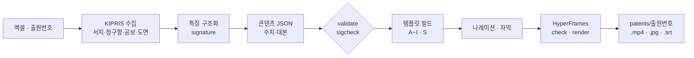

| 단계 | 하는 일 | 도구 |
|---|---|---|
| 1. 준비 | 프로젝트 폴더, 폰트·템플릿 복사, 엑셀·출원번호로 제작 순서 정리 | `setup_project.py`, `master_list.py` |
| 2. 명세 수집 | 서지·청구항·공보 전문·도면 | `kipris.py`, `extract_figs.py` |
| 3. 특징 구조화 | 한 문장 요약 + 다섯 질문 → `signature` (도면을 직접 열어 좌표를 찍음) | Claude / 서브에이전트, `sigcheck.py` |
| 4. 콘텐츠 작성 | 명세서 수치 그대로, 말하는 문장의 나레이션 대본 | `validate.py` |
| 5. 빌드·검사·렌더 | 템플릿 빌드 → 나레이션·자막 → HyperFrames 검사 → 렌더 → `patents/`로 내보내기 | `produce.py`, `export.py` |
| 6. 마무리 | 원본 엑셀 사본의 마지막 열에 영상 파일명 기재 | `annotate_lists.py` |

자세한 사용법은 [`SKILL.md`](SKILL.md), 템플릿 구성과 모션 원칙은 [`references/templates.md`](references/templates.md),
콘텐츠·시그니처·나레이션 작성 규칙은 [`references/CONTENT_SPEC.md`](references/CONTENT_SPEC.md)를 보세요.

## 템플릿

같은 특허(등록특허 10-2336838 팽화미 쌀맥주 제조 기술) 하나로 만든 장면입니다.

<table>
  <tr>
    <td width="50%"><b>A 언팩</b> · 16:9 · 60초<br><sub>검은 무대의 그라디언트 코드네임, 스펙 칩, 도면 스포트라이트. 발표회·전시용</sub><br>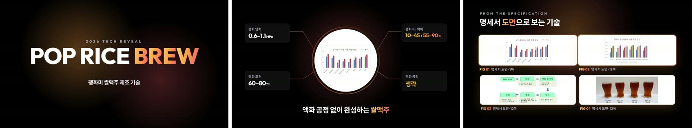</td>
    <td width="50%"><b>D 그린 에디토리얼</b> · 16:9 · 60초<br><sub>민트 종이와 숲색 인터루드, 유리 카드. 기관 홍보형</sub><br>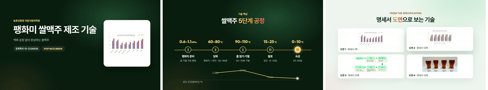</td>
  </tr>
  <tr>
    <td><b>E 모노 콘트라스트</b> · 16:9 · 56.5초<br><sub>흑·백·남색 격자를 오가는 중앙 서사, 도면이 바뀌는 스테이지</sub><br>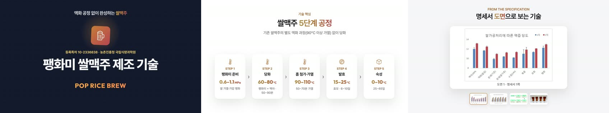</td>
    <td><b>G 스위스 그리드</b> · 16:9 · 60초<br><sub>종이색 그리드, 큰 숫자, 빨강 한 색 강조, 파티클로 조립되는 코드네임</sub><br>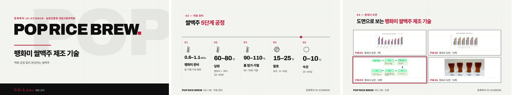</td>
  </tr>
  <tr>
    <td><b>H 오가닉 소프트테크</b> · 16:9 · 57.5초<br><sub>베이지 바탕의 둥근 카드와 방사형 노드, 물결 경로 위 공정</sub><br>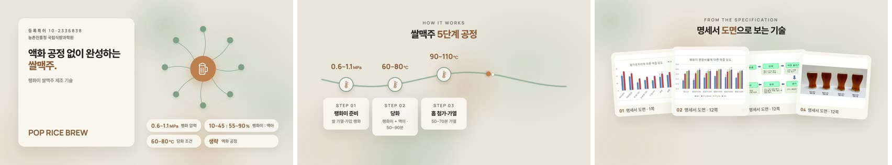</td>
    <td><b>I 뉴스룸 에디토리얼</b> · 16:9 · 56초<br><sub>세리프 제목, 이중 괘선, 공정 표, 도면 포토 에세이</sub><br>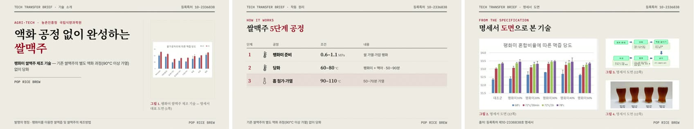</td>
  </tr>
</table>

**세로형 숏폼 (9:16)**

<table>
  <tr>
    <td width="33%"><b>B 카드뉴스</b> · 50초<br><sub>흰 카드가 옆으로 넘어가는 정보형</sub><br>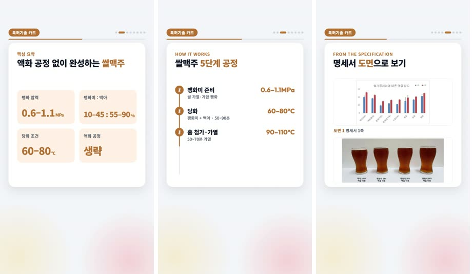</td>
    <td width="33%"><b>C 키네틱</b> · 49.5초<br><sub>원색 면과 거대 숫자·단어로 끊어 가는 릴스형</sub><br>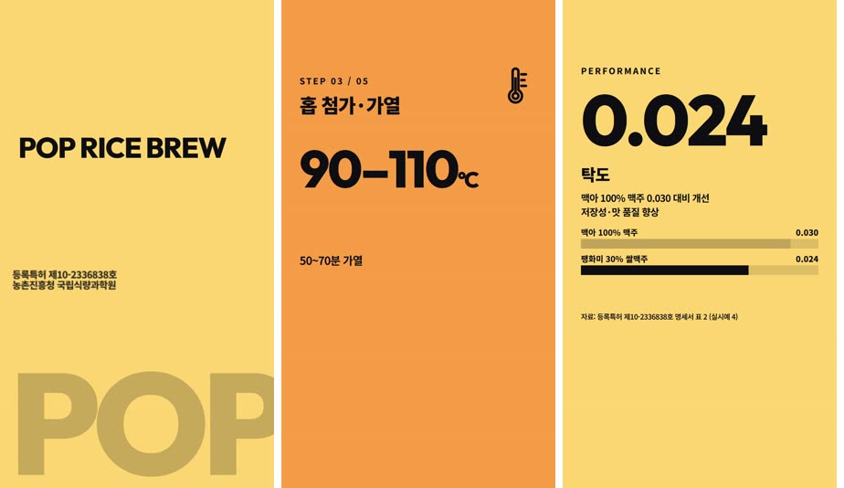</td>
    <td width="33%"><b>F 스테이트먼트</b> · 40.5초<br><sub>한 화면 한 메시지의 짧은 광고형</sub><br>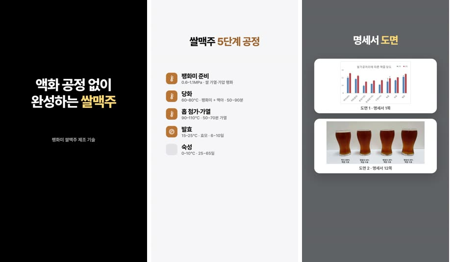</td>
  </tr>
</table>

## 시그니처 템플릿 S

**특허의 구조가 장면이 됩니다.** 16:9 · 40.5~56.5초. 장면 수와 길이는 그 특허의 데이터(단계·부품·프라이머 수)에 맞춰 정해지고,
데이터가 있을 때만 장면이 더해집니다(공정 비교, 두 번째 도면 경로, 프로브 비교).

| 특허 | 유형 | 화면의 주인공 |
|---|---|---|
| 식품·가공·추출·발효 공정 | **journey** · 49.5~54.8초 | 재료 그림이 단계마다 바뀌고 온도 그래프가 이어짐 |
| 장치·설비·재배 시스템·센서, SW·제어 시스템 | **loop** · 44.5~54.4초 | 도면 위로 공기·물·가스·빛·전력이 실제 경로를 따라 흐름 |
| 프라이머·마커·진단 키트 | **sequence** · 49.5~56.5초 | 프라이머가 염기를 찍고 표적에 붙어 Ct 곡선·튜브 색·밴드로 판독 |
| 조성물·추출물·기능성 소재 | **formula** · 41.0~46.7초 | 성분이 비율대로 용기를 채우고 효능이 대조군 대비 막대로 |
| 품종·균주 | **lineage** · 41.0~47.3초 | 교배(분리원)에서 신품종까지 계보, 대비 품종과 형질 비교 |
| 그 밖의 모든 특허 | **claim** · 40.5~47.1초 | 독립항이 구성요소별로 조립되고 도면 위 제자리에 연결 |

<table>
  <tr>
    <td width="33%"><b>journey</b> — 재료가 바뀌는 길<br>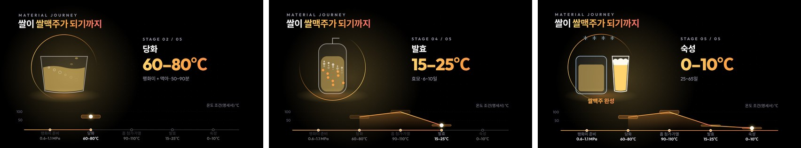</td>
    <td width="33%"><b>loop</b> — 도면 위로 흐르는 매질<br>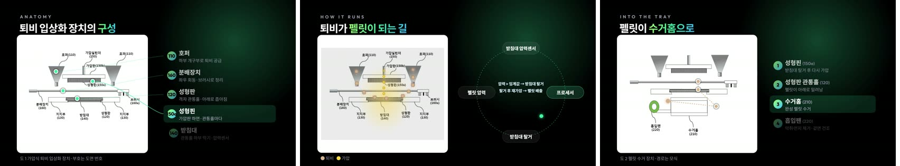</td>
    <td width="33%"><b>sequence</b> — 인식하고 판독한다<br>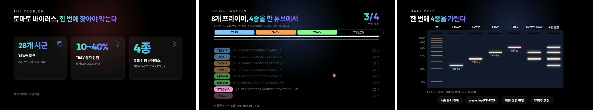</td>
  </tr>
</table>

<details>
<summary><b>유형별 자세한 설명</b></summary>

- **공정형 (journey)** — 4~6단계마다 재료 그림이 바뀌고(침지·절단·증숙·데침·건조·로스팅·유탕·동결·발효·혼합·추출·분쇄·성형·접종·살균·코팅·포장·농축·수확·압출·굽기·발아·재배·세척·탄화·해동·광 조사·초음파 등 33종),
  명세서 온도 조건으로 그래프가 단계별로 이어지며 점이 다음 온도로 옮겨 갑니다. 마지막에 완성품이 나타납니다.
- **장치형 (loop)** — 명세서 도면에 부품을 짚고, 같은 도면 위로 매질이 실제 경로를 따라 흐릅니다.
  옆에는 청구항의 제어 루프(센서 → 제어 → 구동)나 작동 단계가 돌고, 두 번째 도면이 있으면 그 위로 경로를 따라갑니다.
- **배합형 (formula)·계통형 (lineage)** — 조성물·추출물은 성분이 명세서 비율대로 용기를 채운 뒤 효능이 대조군 대비 막대로, 품종·균주는 계보가 그려진 뒤
  형질이 대비 품종과 나란히 비교됩니다. 공정·장치·서열이 없는 특허도 시그니처로 만들 수 있습니다.
- **청구항형 (claim)** — 다른 유형이 맞지 않으면 씁니다(항원·화합물·용도 발명 등 모든 특허에 쓸 수 있는 범용 유형). 독립항이 구성요소별로 하나씩 조립되고,
  구성요소마다 선이 그어져 도면 위 그 자리에 닿습니다. 이어 특징부가 빛나며 무엇이 새로운지 보이고, 청구항 지도에서 종속항이 가지를 뻗습니다.
- **서열형 (sequence)** — 배경기술 수치로 문제를 세우고, 프라이머가 실제 염기를 한 글자씩 찍은 뒤 표적 부위로 날아가 켜집니다.
  판독은 명세서의 방식대로 Ct 증폭 곡선, 반응 튜브 색 변화, 다중 전기영동 밴드(실제 bp) 중 하나입니다.
- **미생물·균주**는 배양·발효가 핵심이면 journey, 진단 마커가 있으면 sequence, 선발된 균주 자체면 lineage를 씁니다.

</details>

## 도면 분석

장치·시스템 특허의 구성 장면(모든 템플릿 공통). 흑백 선 도면이면 선을 자동으로 뽑아 펜으로 그리듯 그리고(`figtrace.py`),
원본 도면이 떠오른 뒤 부품마다 도면 부호 표식이 목록과 같은 순서로 그 자리에 나타납니다. 부품 위치는 `figmap.py`가 만든
"부호의 설명" 대조표와 10×10 측정 격자를 보고 찍습니다([`references/FIGURE_ANALYSIS.md`](references/FIGURE_ANALYSIS.md)).
사진·컬러 렌더 도면은 선 그리기 없이 원본과 표식만 나옵니다.

<p align="center">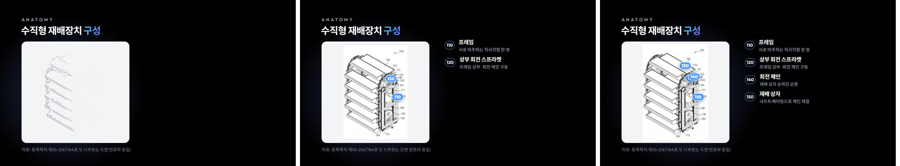</p>

## 설치와 요구사항

| 필요한 것 | 용도 |
|---|---|
| **Node.js 22+**, npx | HyperFrames 검사·렌더(`hyperframes@0.9.104`이 Node 22 이상을 요구) |
| **ffmpeg** (`ffprobe` 포함) | 음성 길이 측정, 썸네일, 내보내기 |
| **Python 3.10+** · `openpyxl` `pypdf` `fonttools` `brotli` `numpy` | 수집·빌드·검사 스크립트 (`requirements.txt`) |
| **uv** (`uvx`) | 기본 나레이션 edge-tts 실행. Google 음성만 쓰거나 `--no-narrate`면 없어도 됨 |

- `setup_project.py`가 끝나면 빠진 도구를 알려 주고, `produce.py`도 시작할 때 Node 22+·numpy·(나레이션 시) uvx와 음성을 검사해 빌드 전에 멈춥니다.
- 첫 검사 때 hyperframes(약 120MB)와 렌더용 Chrome(약 330MB)을 받습니다. 미리 받으려면 `npx --yes hyperframes@0.9.104 browser ensure`.
- edge-tts는 OS 인증서 저장소를 쓰므로 TLS 검사 프록시가 있는 기관망에서도 동작합니다.
- Windows에서 출력을 파이프나 파일로 받을 때는 `python -I -X utf8 ...`으로 실행합니다(`PYTHONIOENCODING`은 `-I`가 무시합니다).

<details>
<summary><b>설정 — 키와 엔딩 문구</b></summary>

| 항목 | 위치 | 비고 |
|---|---|---|
| `KIPRIS_API_KEY` | 프로젝트 `.env` | 없으면 공보 PDF를 받아 `kipris.py --pdf`로 추출. 커밋 금지 |
| `GOOGLE_TTS_API_KEY` | 프로젝트 `.env` | 있으면 Google Chirp 3 HD 음성. Cloud 콘솔에서 Text-to-Speech API를 켜고 발급(유료, 월 무료 한도 있음) |
| 기술이전 문의처·면책 문구 | 프로젝트 `branding.json` | 특허마다 다르면 콘텐츠 JSON의 `branding` |
| 음성 선택 | `produce.py --voice` | `SunHi`, `Kore`처럼 이름만 줘도 전체 ID로 바뀜 |
| 나레이션·자막·배경음악·발음 검사 끄기 | `--no-narrate`, `--no-captions`, `--no-music`, `--no-stt` (기본값은 `brief.json`) | 발음 검사는 편당 약 30초, 첫 사용 때 모델 약 480MB |

</details>

<details>
<summary><b>이 저장소에 없는 것</b></summary>

| 항목 | 이유 | 대신 |
|---|---|---|
| KIPRIS Plus 서비스키 | 비밀 정보 | 프로젝트 `.env`에 `KIPRIS_API_KEY=...` |
| 효과음 | Pixabay 콘텐츠를 단독 재배포하지 않음 | HyperFrames `media-use` 스킬이 설치돼 있으면 `setup_project.py`가 자동 복사(없으면 생략) |

</details>

## 보안

- KIPRIS 호출은 HTTPS만 사용하고, 공보 PDF는 KIPRIS 도메인에서만 받습니다.
- 콘텐츠 JSON은 모델이 제3자 문서(명세서)에서 쓴 것이므로 `validate.py`가 `<br />` 외 HTML 태그, 경로가 섞인 도면 파일명,
  형식이 맞지 않는 시그니처 데이터(좌표·서열·도면 파일)를 거부합니다.
- 실행 시 받는 도구는 버전을 고정합니다: `hyperframes@0.9.104`, `edge-tts==7.3.1`, GSAP `3.15.1`(jsDelivr).
- edge-tts는 Microsoft Edge 온라인 읽기 서비스를 비공식으로 사용합니다(나레이션 문장이 외부로 전송됨). 공공 배포 전 이용 조건을 확인하세요.
- HyperFrames CLI는 기본으로 사용 통계를 PostHog에 보냅니다. 스킬이 실행하는 검사·렌더는 `HYPERFRAMES_NO_TELEMETRY=1`로 끕니다.
  `npx hyperframes`나 `npm run render`를 직접 실행할 때도 끄려면 이 환경 변수(또는 `DO_NOT_TRACK=1`)를 먼저 설정하세요.

## 테스트

나레이션 읽기 규칙(숫자·단위·범위·조사)은 정답표로 검사합니다. 네트워크와 TTS 없이 1초 안에 끝납니다.

```bash
python -I -X utf8 -m unittest discover -s tests
```

규칙을 의도적으로 바꿨다면 `tests/test_narration.py`의 기대값도 같은 커밋에서 고칩니다.

## 기록과 고지

- 일일 점검 결과와 외부 도구 검토 내역: [`docs/daily-check.md`](docs/daily-check.md)
- 서드파티 고지: [`NOTICE.md`](NOTICE.md). 이 저장소의 코드에 대한 라이선스는 아직 지정되지 않았습니다.
- 아이콘은 [Tabler Icons](https://github.com/tabler/tabler-icons) 3.35.0(MIT)의 선 아이콘 40종에 옅은 채움을 더해 씁니다.
- README 구성은 [Ublaze/github-readme-generator](https://github.com/Ublaze/github-readme-generator)(MIT)의 구조를 따랐습니다.
